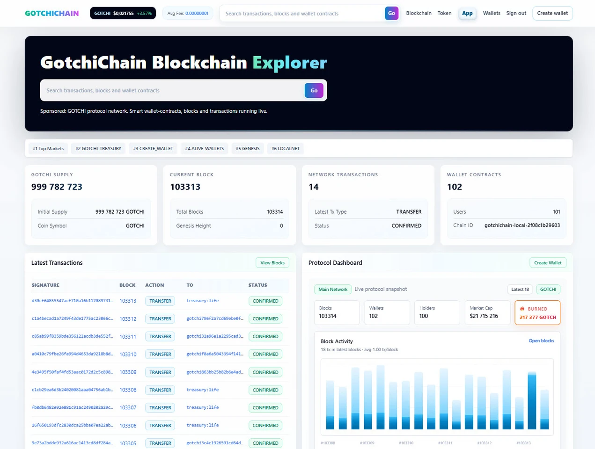
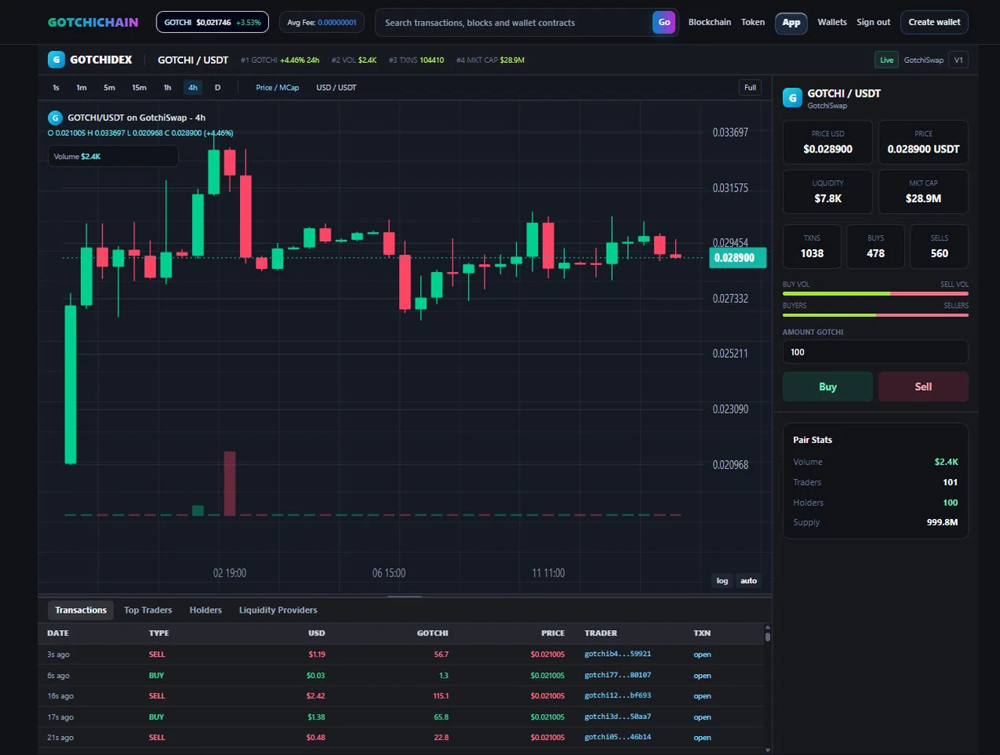

# GotchiChain - прототип блокчейн-протокола

**Автор проекта:** [Евгений Толмачев](https://github.com/EvgenyET) · [Страница проекта в портфолио](https://evgeny-dev.pro/project.html?id=GotchiChain)

Локальный прототип на TypeScript: блоки, транзакции, кошельки-контракты и PostgreSQL. Веб-интерфейс для изучения состояния и тестовых операций.

## Мой вклад

Разработал локальный прототип протокола и обозреватель его состояния. Реализовал обработку переводов, формирование связанных блоков и сохранение состояния в PostgreSQL. Собрал веб-интерфейс, чтобы проверять прохождение транзакций и исследовать работу протокола.

## Интерфейс

**Обозреватель блоков и активности сети**

**Торговый терминал прототипа**

## Как это работает

Исследовательский проект для моделирования серверной части блокчейн-протокола. Runtime создаёт начальное состояние, обрабатывает транзакции, изменяет состояния кошельков-контрактов и собирает блоки с хешами. Данные сохраняются в PostgreSQL через Prisma. Веб-приложение показывает блоки, транзакции, счета и торговый терминал для локальных сценариев. Отдельная Electron-панель управляет сервером, фронтендом и имитацией активности. Текущий результат - локальный прототип протокола, без заявления о готовой распределённой сети.

## Возможности

- Инициализация начального блока и состояния протокола с системным кошельком.
- Создание кошельков-контрактов, переводы и системное сжигание с проверкой входных данных.
- Формирование связанных блоков, расчёт хеша блока и хеша состояния.
- Просмотр блоков, транзакций и счетов через веб-интерфейс и HTTP API.
- Тестовый торговый терминал со свечами и локальная панель управления сервисами.

## Технологии

- **TypeScript** - Типы протокола, серверная логика и клиентские модели.
- **Fastify** - HTTP API для работы с состоянием протокола.
- **Prisma / PostgreSQL** - Модели, миграции и постоянное хранение состояния.
- **Next.js / React** - Страницы обозревателя, кошельков и торгового терминала.
- **Electron** - Локальная панель запуска сервисов и тестовой активности.

## О проекте

Исследовательский локальный прототип блокчейн-протокола. Проект позволяет проследить путь транзакции от запроса API до изменения состояния и записи блока в базу, а затем увидеть результат в веб-обозревателе.

Коммерческий проект. Исходный код закрыт.
